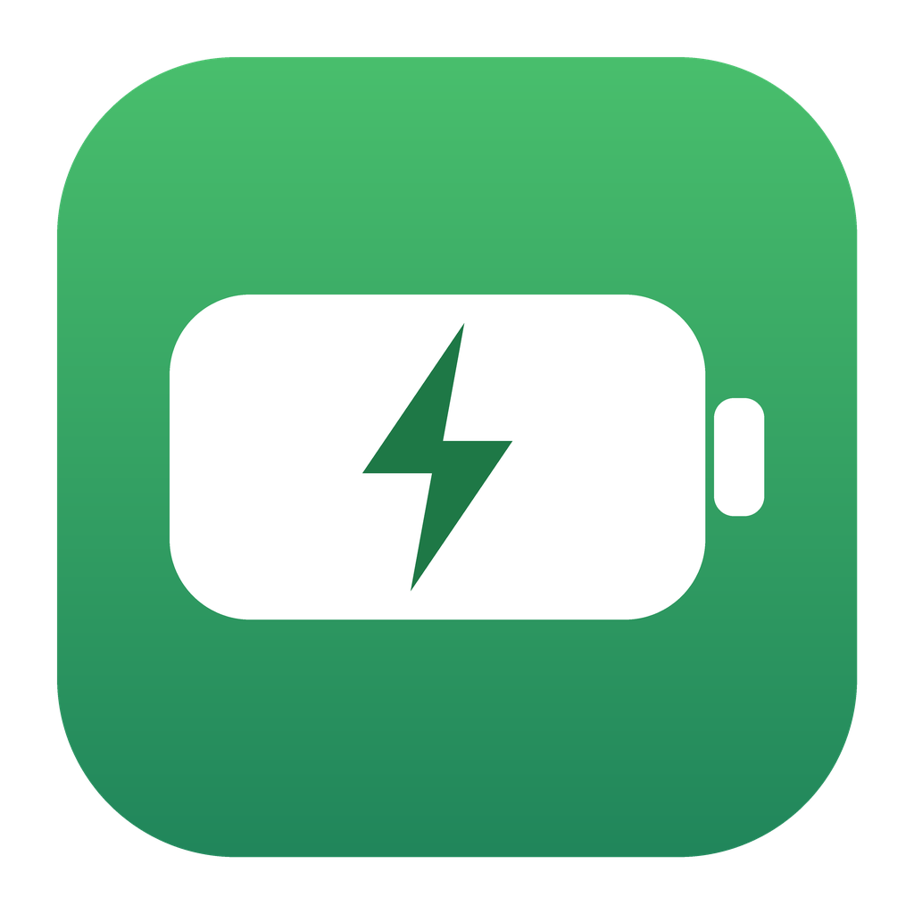
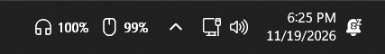
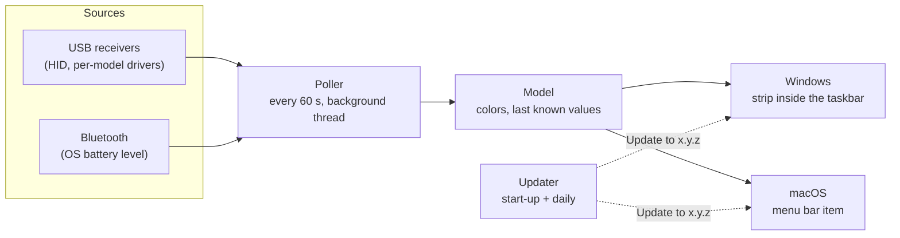

<div align="center">



# Chargestrip

**Battery levels of your wireless gear, right where you look: the taskbar.**

A tiny native app for Windows and macOS that shows the charge of your wireless headset, mouse,
keyboard and Bluetooth devices, without keeping vendor software running.

[](https://github.com/erogluuefe/chargestrip/releases/latest)
[](https://github.com/erogluuefe/chargestrip/actions/workflows/release.yml)
[](LICENSE)


[**Download**](https://github.com/erogluuefe/chargestrip/releases/latest) ·
[Supported devices](#supported-devices) ·
[How it works](#how-it-works) ·
[Add a device](#adding-a-device)

<br>



<sub>Windows: headset at 100 %, mouse at 99 %, sitting just left of the tray arrow.</sub>

</div>

---

## Why Chargestrip

- **Always in view.** On Windows the levels live *inside* the taskbar, next to the `^` tray arrow,
  as real text and icons, not a tray icon you have to hover, and on every monitor's taskbar. On
  macOS it is a single menu bar item. Hover over a device for its name and state.
- **Featherweight.** One ~380 KB executable, ~2 MB of private memory, three threads, five runtime
  dependencies. No services, no background updater process, no web runtime.
- **No vendor suites.** Reads the battery straight from the USB receiver or from the operating
  system, so the manufacturer's software can stay closed.
- **Read-only by design.** Chargestrip only sends the same status queries the vendor software sends
  on its own. It never writes settings to a device.
- **Quietly up to date.** Checks for a new release at start-up and once a day. When one exists, an
  *Update to x.y.z* entry appears in the menu; one click downloads, installs and restarts.
- **Open source.** GPL-3.0, written in Rust, built and released by a public CI pipeline.

## At a glance

| You see | Meaning |
|---|---|
| `🎧 82%` in the regular taskbar color | Connected and discharging |
| `🖱 12%` in **red** | 15 % or less, charge soon |
| `🎧 64%` in **green** | Charging |
| `🖱 40%` in **gray** | Receiver plugged in, device off or asleep: last known value |
| `🖱 –` in **gray** | Device off, no reading yet in this session |
| `🔋 –` | Running, but no supported receiver or Bluetooth device found |

On macOS the menu bar item uses monochrome SF Symbols that follow the menu bar's light or dark
appearance, like Apple's own items. Menu bar items have a single color, so the state is a small mark
instead: a bolt while charging, a warning sign at 15 % or less, and a dimmed item while the device is
off or asleep. Hover over it for a text summary.

Hover over a device for a tooltip such as *SteelSeries Arctis Nova 7P: 64% — charging*. Click the
strip (left or right) or the menu bar item for **Refresh**, **Start at login**, **Check for
updates**, **Copy diagnostics** and **Quit**. The interface follows the system language (English
and Turkish today; English for everything else).

**Multiple monitors and taskbar layouts (Windows).** Every taskbar gets its own strip. On the main
taskbar it sits left of the `^` arrow. Other monitors' taskbars have no notification area, so on
Windows 11 the strip uses the free left end (or follows the taskbar buttons when they are
left-aligned), and on Windows 10 the right end. On a vertical taskbar (Windows 10) the devices are
stacked just above the notification area.

## Install

### Windows 10 / 11

1. Download **`Chargestrip-Setup-x.y.z.exe`** from the [latest release](https://github.com/erogluuefe/chargestrip/releases/latest).
2. Run it. No administrator rights needed: it installs for the current user only, in
   `%LOCALAPPDATA%\Programs\Chargestrip`, and can start with Windows.
3. The installer is not code-signed, so SmartScreen may warn the first time:
   **More info → Run anyway**.

Uninstall from *Settings → Apps*. Later versions arrive through the app's own **Update** menu entry.

### macOS 11+

The quickest way is one line in Terminal. It downloads the latest release, copies it to
*Applications* and opens it:

```sh
curl -fsSL https://raw.githubusercontent.com/erogluuefe/chargestrip/main/scripts/install-mac.sh | sh
```

Or install manually: open **`Chargestrip-macOS-x.y.z.dmg`** and drag Chargestrip to *Applications*.
The app is ad-hoc signed but not notarized by Apple, so a browser download is blocked on first
launch: open *System Settings → Privacy & Security* and click **Open Anyway**. (The one-liner above
avoids this, because `curl` downloads are not quarantined.)

## Supported devices

| Device | Connection | USB IDs | Status |
|---|---|---|---|
| SteelSeries Arctis Nova 7P | 2.4 GHz receiver | `1038:220A`, `22A7`, `2298` | ✅ Verified on hardware |
| Waizowl OGM Pro V2 | 2.4 GHz "OGM 8K" receiver | `1915:0728` | ✅ Verified on hardware |
| Fractal Design Scape | 2.4 GHz receiver or USB-C cable | `36BC:0001`, `2001` | 🧪 Documented protocol |
| Razer wireless mice and keyboards (e.g. DeathAdder V3 Pro) | HyperSpeed receiver or cable | `1532:…` (~250 IDs) | 🧪 Documented protocol |
| Logitech mice and keyboards (e.g. G915 X) | LIGHTSPEED, Unifying or Bolt receiver | `046D:C539`, `C547`, `C548`, … | 🧪 Documented protocol |
| ATK / VXE (incl. NearLink), Kysona, Pulsar, Redragon, Hitscan, G-Wolves mice | Compx-based receiver | `373B:…`, `3554:…`, `3710:…`, `3770:…`, `33E4:…` | 🧪 Documented protocol |
| AJAZZ AK820 Pro / MAX, AK980 V2, AULA F108 Pro (SONiX) | 2.4 GHz receiver (not cable or Bluetooth) | `0C45:FDFD`, `FEFE`, `05AC:024F` | 🧪 Documented protocol |
| **Any Bluetooth device** with a battery level | Bluetooth | — | 🧪 Uses the OS value |

✅ tested with the real device. 🧪 implemented from a public, hardware-tested protocol; it has not
been tried with that device in Chargestrip yet. If yours is missing or wrong, click **Copy
diagnostics** in the app's menu and paste the result into a
[new issue](https://github.com/erogluuefe/chargestrip/issues). It lists the app version, the
connected HID receivers and what each driver reads; nothing is sent anywhere by the app.

**Bluetooth** devices appear while connected, whenever the operating system knows their level, i.e.
when *Settings → Bluetooth & devices* (Windows) or the Bluetooth menu (macOS) shows a percentage.
Bluetooth has no charging flag, so these never turn green. macOS refreshes them every five minutes.

<details>
<summary><b>Arctis Nova 7P only shows 0, 25, 50, 75 or 100 %</b></summary>

Firmware released before January 2026 reports the battery in five steps. Updating the headset
firmware once with SteelSeries GG (on any PC) switches the receiver to ID `22A7`, which reports exact
percentages. Chargestrip already supports both, nothing to change on your side.
</details>

## Privacy and footprint

- **No telemetry.** Nothing about you or your devices leaves your computer.
- **Network:** a single `HEAD` request to this repository's
  [`releases/latest`](https://github.com/erogluuefe/chargestrip/releases/latest) page at start-up,
  once a day and on *Check for updates*, plus the installer download when you choose to update.
  It uses the `curl` that ships with Windows 10+ and macOS, so the app carries no TLS stack.
- **Devices:** read-only status queries, at most once a minute, and only to receivers it recognizes.

| | |
|---|---|
| Executable | ~380 KB (Windows, icon included) |
| Installer | ~2.2 MB |
| Private memory | ~2 MB |
| Threads | 3 (UI, device polling, update check) |
| Runtime dependencies (Windows) | 5 crates: `hidapi`, `windows-sys` and their helpers |

## How it works



- **Windows UI** is plain Win32: a layered child window of the taskbar, drawn with GDI and placed left
  of the notification area. It follows taskbar size, DPI, light/dark theme and Explorer restarts,
  and hides with the taskbar in full-screen games.
- **macOS UI** is a status item created with `tao` and `tray-icon`, with no Dock icon.
- **Drivers** are small, self-contained files: which receiver to open (vendor ID, product IDs, HID
  usage) and how to read its reply. Every protocol is covered by unit tests (from real captures
  where the device was available).

## Adding a device

Supporting a new USB receiver usually takes one file and one line.

1. **Find the receiver.** Plug it in and use **Copy diagnostics** in the app's menu, or run the same
   report from source. It lists every vendor-specific HID interface and what each driver reads:
   ```sh
   cargo test probe -- --ignored --nocapture
   ```
2. **Find the protocol.** First look for an open-source project that already supports the device.
   Otherwise record what the vendor software does (listen-only, nothing is sent to the device):
   ```sh
   pip install frida
   python tools/hidspy/run.py "<vendor app>.exe" <vid> capture.log
   ```
   Note the level the vendor app shows, switch the device off and on, plug and unplug the charging
   cable, then match the bytes that change. Only use **read-only** requests the vendor software sends
   by itself. [`docs/waizowl-ogm-protocol.md`](docs/waizowl-ogm-protocol.md) is a worked example.
3. **Write the driver** in `src/devices/<brand_model>.rs`:
   ```rust
   pub const DRIVER: Driver = Driver {
       kind: Kind::Mouse,
       vid: 0x1234,
       pids: &[0x5678],
       interface: Interface::Page(0xFF00), // or Usage(page, usage), Vendor(..), Any
       read,
   };

   fn read(dev: &HidDevice, _pid: u16) -> Option<Found> {
       exchange(dev, &REQUEST, |reply| /* decode if this is our reply, else None */)?
           .map(Found::from)
   }
   ```
   Add unit tests with frames from your capture.
4. **Register it** in `src/devices/mod.rs`: `mod <brand_model>;` and one entry in `DRIVERS`. The UI
   needs no changes.

Bluetooth devices need no driver at all.

## Building from source

Requirements: the latest stable [Rust](https://rustup.rs). On Windows, the MSVC toolchain with the
Visual Studio Build Tools (Windows SDK included).

```sh
cargo build --release          # target/release/chargestrip(.exe)
cargo test                     # unit tests
```

Windows installer: install [Inno Setup 6](https://jrsoftware.org/isinfo.php), build the release
executable, then `ISCC.exe /DAppVersion=1.2.3 installer\chargestrip.iss` (output in `dist\`).

### Releasing

1. Bump `version` in `Cargo.toml` and commit.
2. Tag and push: `git tag v1.2.3 && git push origin v1.2.3`.
3. [GitHub Actions](.github/workflows/release.yml) runs the tests on Windows and macOS, builds the
   installer and the ad-hoc-signed `.dmg`, and publishes the release. Installed copies offer the
   update within a day.

## Project layout

```text
src/
  main.rs              entry point, platform selection
  model.rs             battery state → what to show (platform independent)
  poller.rs            background polling, last known values
  update.rs            release check, download, silent install
  i18n.rs              UI strings (English, Turkish)
  devices/
    mod.rs             Driver, Reading, DRIVERS, poll(), exchange()
    arctis_nova7.rs    one file per device model or family
    compx.rs
    fractal_scape.rs
    logitech.rs
    razer.rs
    sonix.rs
    waizowl_ogm.rs
    bluetooth/         OS battery levels (windows.rs, macos.rs)
  win/                 Win32 message loop, taskbar strip, autostart
  mac/                 menu bar item (mod.rs), its template image (title.rs), LaunchAgent autostart
assets/                logo and the script that renders it
installer/             Inno Setup script
scripts/               macOS one-line installer
tools/hidspy/          HID traffic recorder for reverse engineering
docs/                  protocol notes
```

## Contributing

Issues and pull requests are welcome, especially new devices. For a device request, include the
model, its connection type and the output of **Copy diagnostics**. Please keep changes small, tested and in the
spirit of the project: native, light and read-only.

## License

Copyright © 2026 erogluuefe

Chargestrip is free software, licensed under the [GNU General Public License v3.0 or later](LICENSE).
You may use, study, modify and share it; if you distribute a modified version, its source must be
released under the same license. Provided without any warranty.
